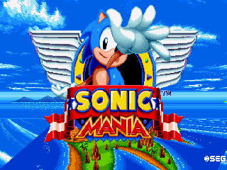
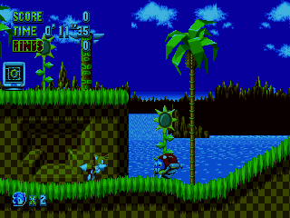
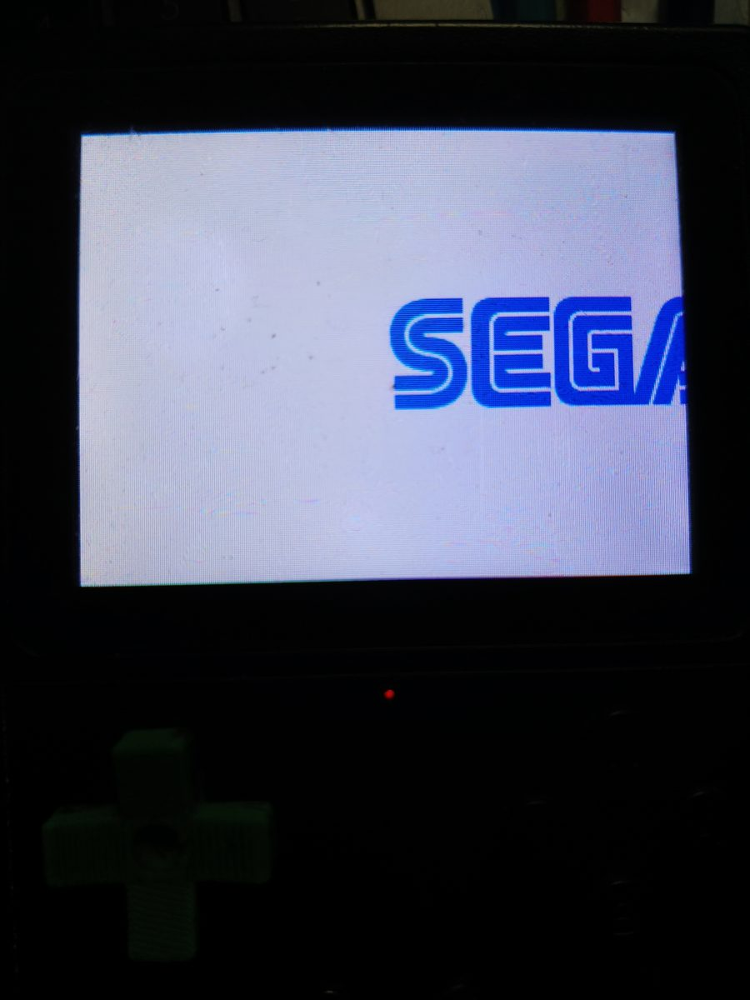

# FroggyMania

Sonic Mania running on the **SF2000 / GB300** handheld, with gamepad-only
controls and no firmware modifications.






## What this is

Sonic Mania is the official SEGA game built on the **RSDKv5** engine, whose
decompilation ([Sonic-Mania-Decompilation][decomp]) is a portable C++ codebase.
This project ports that codebase to the SF2000/GB300: a 320x240 MIPS32 handheld
with **no FPU**, no keyboard and no mouse. Input is mapped onto the gamepad, the
renderer targets the console's LCD, and the game runs as a libretro core on top
of a modified [sf2000_multicore][multicore] frontend.

**No game data is included or distributed.** You need your own copy of Sonic
Mania Plus (`Data.rsdk`, version 1.06.0503) — see *Requirements*.

## Releases

Prebuilt, plug-and-play packages are in [`packages/`](packages) and attached to
releases. Each contains a self-contained installer:

```sh
./install.sh /media/$USER/GB300 gb300v2
```

The installer copies the core to every path the different firmware loaders look
at (`system/Deimos/cores/`, `cores/`, `ROMS/sonicmania/`), drops the small
launcher stubs and adjusts the recommended frontend options. It never touches
`Data.rsdk`.

## Requirements

* **Sonic Mania / Sonic Mania Plus (PC), version 1.06.0503** — copy its
  `Data.rsdk` to `ROMS/sonicmania/Data.rsdk` on the card. Without it the core
  refuses to start.
* **GB300 V2** (the build in `packages/`). Plain SF2000 support is untested.

## Controls

| Input | Action |
|---|---|
| D-pad | move / navigate menus |
| A / B | jump (accept / back in menus) |
| X / Y | extra action buttons |
| START | pause / confirm |
| SELECT | select |
| L / R | shoulder buttons |

## Status

Early preview. The full boot sequence (logos → SEGA screen → animated title),
the menus, save data and gameplay all work, verified on a GB300 V2 through
Green Hill Zone and Angel Island Zone.

Known rough edges:

* **Performance.** The CPU has no FPU; the engine is soft-float. Busy scenes
  drop frames. Physics/input stay at 60 Hz — rendering skips frames — so the
  game remains playable, but smoothness varies by scene.
* Occasional glitches and crashes are still being chased down.

## Notable implementation points

The port is mostly the upstream decompilation and the upstream frontend. The
parts that needed real work:

* **Rendering pipeline.** The engine renders at the original 424x240 and the
  core downscales to the panel's 320x240 with a lookup-table scaler. The
  console's OSD region cannot exceed 320 pixels wide (fixed-size buffer in the
  stock firmware), which is why the core presents a pre-scaled 320x240 frame
  instead of handing 424 pixels to the frontend.
* **Broken alpha and fill.** The stock RGB565 blend macro overflowed on
  rounding, red-shifting sprites; it was replaced with a bit-exact branchless
  blend, and the screen-clear path was rewritten to use the full 6-bit green
  channel.
* **MIPS unaligned access.** All object-variable reads/writes go through
  byte-wise helpers (`ReadBytes`) — direct 32-bit loads/stores on packed data
  raise `AdEL`/`AdES` CPU exceptions. Chasing `exception 4/5` at raw addresses
  through the linked ELF map was most of the debugging effort.
* **Soft-float performance.** The audio mixer and the sprite blitter (the two
  hottest loops) were rewritten/relaid out for the MIPS build (`-O3`,
  branchless clamps, hot-loop unrolling), and a frame-skip option
  (`Video:frameSkip`) keeps input latency at 60 Hz when the renderer falls
  behind.
* **Struct-layout trap.** `RSDKScreenInfo` is declared twice (engine and game
  headers). If they disagree by even one padding word the framebuffer pointer
  shifts and the picture breaks; both copies now use the same padded stride.
* **Input plumbing.** The frontend had to call the port's
  `InitInputDevices()` and hook the game's `ControllerInfo[]` array base, since
  the game indexes controller slots internally.

## Repository layout

```
packages/    prebuilt packages + installer (also attached to releases)
docs/        screenshots
source/      full source of both components
  sonicmania-sf2000/   the decompilation + SF2000 platform layer (libretro core)
  sf2000_multicore/    multicore frontend (libretro host for the console)
```

## Building from source

Cross toolchain: `mipsel-mti-elf` (the [frog-toolchain][toolchain] build works).

```sh
# 1. the game core -> sonicmania_libretro_sf2000.a
cd source/sonicmania-sf2000
make clean && make platform=sf2000

# 2. the frontend loader + final core -> build/core_87000000
cd ../sf2000_multicore
make VIDEO_SF2000_DEBUG=1 FROGGY_TYPE=GB300V2 \
     CORE=cores/sonicmania CONSOLE=sonicmania
```

Then deploy `build/core_87000000` to the card (the installer in `packages/`
shows the exact paths).

There is also a host-side test harness under
`source/sonicmania-sf2000/runner/` that links the core against a native build
and dumps frames — useful for reproducing rendering bugs without the console.

## Verifying the data file

The core was developed and tested against **Sonic Mania Plus, data version
1.06.0503** (the same `Data.rsdk` shipped with the 2018 PC re-release). Other
versions are untested.

## Third party code

* Sonic Mania decompilation — [Rubberduckycooly/Sonic-Mania-Decompilation][decomp]
  (see `source/sonicmania-sf2000/LICENSE.md`)
* RSDKv5 decompilation — [Rubberduckycooly/RSDKv5-Decompilation][rsdk]
* Multicore frontend — ISC, from [gitlab.com/kobily/sf2000_multicore][multicore]
  (see `source/sf2000_multicore/LICENSE`)

Sonic Mania and its assets are © SEGA. No game data is distributed with this
project; `Data.rsdk` must be provided by the user from their own copy of the
game.

[decomp]: https://github.com/Rubberduckycooly/Sonic-Mania-Decompilation
[rsdk]: https://github.com/Rubberduckycooly/RSDKv5-Decompilation
[multicore]: https://github.com/madcock/sf2000_multicore
[toolchain]: https://github.com/madcock/frog-toolchain
